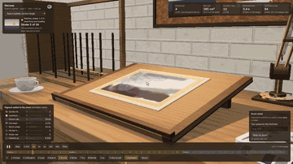
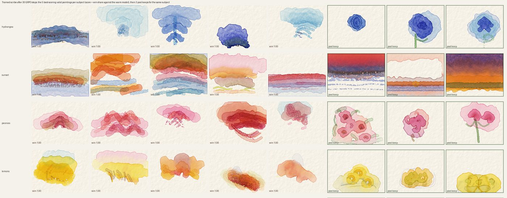
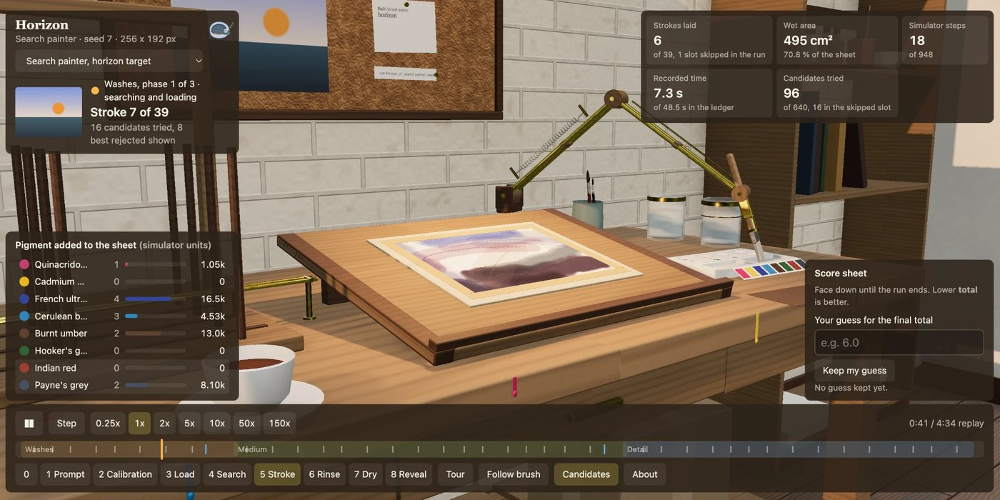
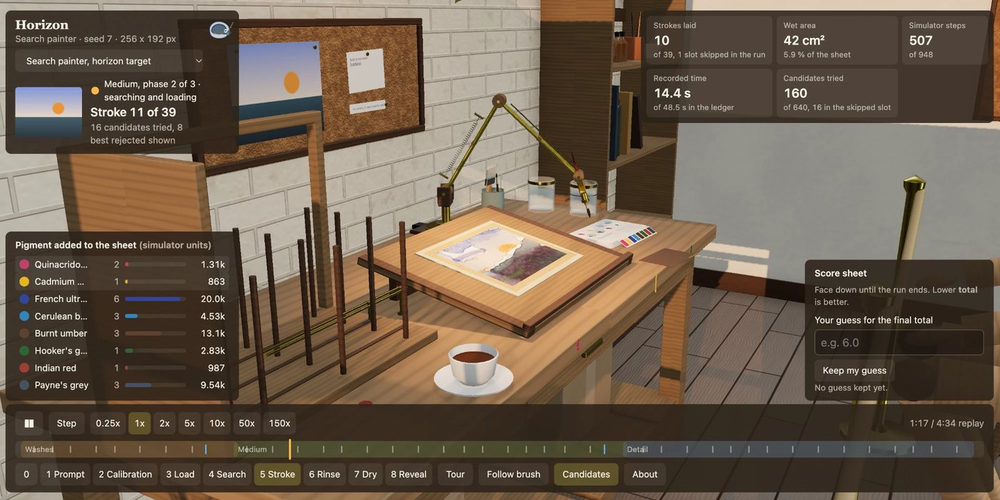
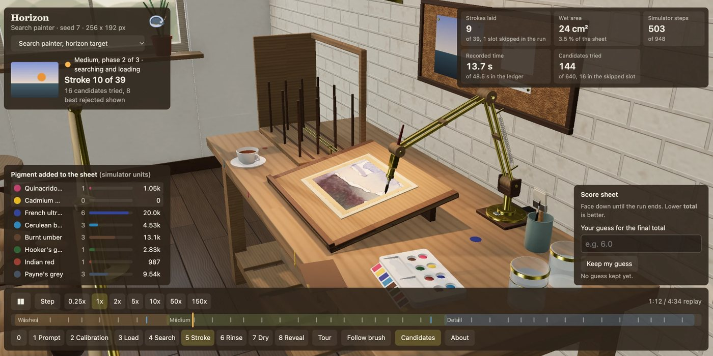

<h1 align="center">Backrun</h1>

<p align="center">
  
</p>

Every painting in this repository can be replayed stroke by stroke in [the studio](https://dervinevolve.github.io/backrun/); the recording above is the search painter's horizon run, from the first washes to the score sheet turning over.

A backrun is what happens when fresh water touches a wash that has started to dry: the new water pushes the pigment outward and leaves a hard, cauliflower-shaped edge. Beginners get them by accident. Painters learn to cause them on purpose. This project is a small watercolour physics model on a grid, a stroke file that any painting can be replayed from exactly, and three painters that try to use the water well: a search, a network that imitates the search, and a language model that writes the stroke file from a text prompt and is trained by a judge.

I do these experiments for fun.

## Three painters

| The search painter | The learned painter | The scribe |
|---|---|---|
|  |  |  |
| Tries sixteen strokes per slot, keeps the one whose predicted dry result scores best. Forty slots, about fifty seconds. No learning. | A network trained to imitate the search painter. Looks at the target and the sheet once per stroke, no search, about six seconds. Scores 8.85 on sealed targets against 24.02 for a blank sheet and 5.26 for the search. | A 4B language model writes the whole stroke file from "paint pink peonies, loose and wet". Warmed up on 269 rated paintings, then 30 steps of GRPO with a vision judge. Valid files 91% of the time; the judge prefers it to its warm-up self in 58 comparisons of 100. It places the subject's colours and does not yet draw. |

The search painter's run, stroke by stroke:


## The studio

Every run replays in a small painting room in the browser: a drafting arm lays each recorded stroke, the jars and the palette empty by the recorded amounts, the sheet goes to the drying rack between phases, and the score sheet stays face down until the end so you can guess first. Pick a run from the menu at the top left and press play. Orbit with the mouse, or use the numbered stage cameras along the bottom.

| | |
|---|---|
|  |  |




## Status

| Part | State |
|---|---|
| Simulator: water flow, pigment movement, evaporation, settling, granulation, edge darkening | Done, 71 tests, about 5 ms per step at 256 x 192 on one CPU core |
| Pigment rendering with the Kubelka-Munk model, eight pigments | Done. The pigment numbers are design choices, not measurements |
| Stroke file format, byte-identical replay from file and seed | Done and tested |
| Scorer, kept in its own module the painter never reads | Done |
| Search painter, coarse to fine, no learning | Done, and weak. Its first painting had a sky three times too dark because it judged each stroke while the paper was wet; it now judges on a prediction of how the stroke will dry |
| Learned painter | Stage A, imitation of the search painter. The first GPU run scored no better than a blank sheet, because a regression head averaged the search painter's varied strokes into one muddy dab. A head that picks a start cell and a bin for each other number, trained on 1,000 ledgers, scores `total` 8.85 on the sealed set with 26 times less simulation than the search. One run, five sealed targets, so a direction rather than a result. Numbers in [docs/TRAINING.md](docs/TRAINING.md) |
| The scribe: a language model that writes stroke files from a text prompt, rewarded by a judge | Trained. A pool of 921 paintings from four cheap models, rated; a judge calibrated against my ratings; a warm-up on the 269 keeps; a 10-step pilot that found the judge had nothing to compare because the pool was too strong; then 30 steps against the warm model's own paintings, which worked. About $60 of API and GPU credit end to end. Numbers, pictures and what went wrong in [docs/SCRIBE.md](docs/SCRIBE.md) |
| A studio in the browser where you can watch it paint | Built: a drafting arm replays any run stroke by stroke with the palette, jars, drying rack and a dashboard, and the gallery holds all three painters. Runs locally from `studio/`; a workflow publishes it to GitHub Pages. See [studio/README.md](studio/README.md) |

## What it looks like so far

Three stroke files, each rendered by replaying the file:

| Flat wash | Wet in wet | A wet stroke into a damp wash |
|---|---|---|
|  |  |  |

The rim on the flat wash and the feathering in the second image come out of the physics; nothing in the code draws them. The third image is the honest one: a wet stroke on a damp wash gives a pale patch with a darker ring of pushed pigment, which is the start of a backrun and still a long way from the crisp branching edge of a real one. [examples/README.md](examples/README.md) records what was tried.

## How it works

The paper is a grid. Each cell holds water, pigment floating in the water, pigment that has settled onto the paper, and a paper height from a seeded texture. Each simulation step does five things, in order, only where the paper is wet:

1. **Water moves** downhill along the water surface and the paper texture.
2. **Pigment moves** with the water and spreads a little on its own.
3. **Water evaporates**, faster at the edge of the wet area. Pigment stays behind, so it concentrates where the water last was. That is why edges darken.
4. **Pigment settles** onto the paper, more in the paper's valleys for granulating pigments, and some lifts back into the water.
5. The wet area is updated.

Rendering uses the Kubelka-Munk model from Curtis, Anderson, Seims, Fleischer and Salesin, "Computer-Generated Watercolor" (SIGGRAPH 1997), which is also where the physics above comes from, simplified so one step runs in a few milliseconds. The full plan is in [docs/DESIGN.md](docs/DESIGN.md).

A painting is a JSON Lines file of strokes and drying periods:

```json
{"op": "canvas", "width": 256, "height": 192, "seed": 7, "paper": "cold_press"}
{"op": "stroke", "path": [[12.0, 30.5], [40.0, 20.0], [70.0, 44.0]], "width": 6.0, "water": 0.8, "pigments": {"french_ultramarine": 0.6}}
{"op": "dry", "steps": 200}
```

## A second painter: a language model writes the stroke file

The stroke file is a small language, so a language model can write one from a prompt such as "a harbour at dusk, two boats, low tide", and the simulator paints it in a few seconds. There is no target image to match, so the reward is a judgement: a vision model is shown the painting next to a painting from a rated pool and asked which is the better watercolour of the subject. A gate throws out files that are broken or that try to game the judge with one wide dark wash. The recipe comes from Surya Narreddi and Cameron Franz, who trained a model to paint by writing p5.brush JavaScript, and from Sergio Paniego's open reproduction; what changes here is the medium, with real water and drying time, and a render that takes seconds instead of a minute. The plan, the gate rules, the reward and what is not done are in [docs/SCRIBE.md](docs/SCRIBE.md).

## Try it

The studio runs in the browser with no server. Once the repository is public and Pages is enabled, the workflow in `.github/workflows/studio-pages.yml` publishes it at `https://dervinevolve.github.io/backrun/`; until then:

```bash
cd studio && npm install && npm run dev
```

Open the printed address, pick a run from the menu at the top left, and press play.


```bash
pip install -e ".[dev]"
python -m pytest -q
```

Replay a stroke file to a PNG:

```bash
python -m backrun.cli render examples/wet_in_wet.jsonl out.png
```

Let the search painter paint a built-in test target (no downloads, about a minute on a laptop):

```bash
python -m backrun.cli_paint synthetic:horizon:1 runs/horizon --strokes 40 --candidates 16 --seed 7
```

The run folder gets `strokes.jsonl`, `final.png`, `target.png`, a `ledger.jsonl` with the score after every stroke, and a `frames/` folder. `scripts/make_gif.sh runs/horizon/frames runs/horizon/run.gif` turns the frames into a GIF if ffmpeg is installed.

## The score

`backrun/score.py` compares a painting to its target and returns a few numbers. `total` is the one the painter tries to lower:

```
total = 0.01 * lab_l2 + 4.0 * (1 - ssim) + 0.002 * strokes
```

`lab_l2` is the mean squared colour distance in CIELAB, `ssim` is structural similarity on brightness, and `strokes` is how many strokes were used. Lower is better. The scorer lives in its own module, imports nothing from any painter, and a test checks that the painter imports only the `score` function. A learned perceptual distance may be added later, pinned by hash.

## Data and consent

Targets are my own photos, public-domain images and the built-in synthetic scenes. Every painting in the judge's pool is a stroke file written by a model and rendered by this simulator. I rated the first 108 of the first pool by hand and had Codex, an AI agent, rate the rest from contact sheets; docs/SCRIBE.md says exactly which. No paintings by any artist, living or dead, are used as training data, as targets or as references. The look comes from the physics of water and pigment on paper.

## The catch

It paints what it is shown. Taste stays with whoever picks the targets. The numbers only say how close a painting got to its target and how many strokes it took; whether the result is a good watercolor is for you to judge by looking. Two simulators will never match pixel for pixel, so when a browser version arrives, the stroke file plus seed stays the artifact of record and the Python render of it is the official image.

## Tools

I actively use Codex, Claude, DeepSeek through Hermes, and Kimi to experiment and develop Backrun. They help me try implementations, debug problems, inspect ideas, and review changes. I also use DeepSeek through Hermes and Kimi for security audits.

## License

MIT. See [LICENSE](LICENSE).
